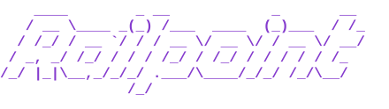

<p align="center"></p>

<p align="center">
  <a href="https://www.npmjs.com/package/railpoint"></a>
  
  <a href="LICENSE"></a>
</p>

CLI that links a Railway service to a custom domain on Namecheap — in one command.

Inspired by [doomain](https://github.com/crafter-station/doomain), scoped to just Namecheap + Railway.

## Quickstart

You need Node 24.2 or later, a [Railway API token](https://railway.com/account/tokens), and a domain on
Namecheap that uses Namecheap BasicDNS.

1. **Turn on the Namecheap API and whitelist your IP.** In Namecheap, go to Profile → Tools → Namecheap API
   Access, turn the API on, copy the API key, and add this machine's public IP (`curl https://api.ipify.org`)
   under Whitelisted IPs. Namecheap rejects calls from any other IP.
2. **Run the wizard.**

   ```sh
   npx railpoint
   ```

   See [The wizard](#the-wizard) for what it asks.

Or, for scripts and CI, set the environment and run `link`:

```sh
export RAILWAY_TOKEN=...
export NAMECHEAP_API_USER=...
export NAMECHEAP_API_KEY=...

npx railpoint link app.example.com --project my-app --service my-api
```

## How it works

`link` takes three steps:

1. **Add the domain on Railway.** It finds the project, environment and service, then adds the custom domain to
   the service. If the domain is already there, it reuses it.
2. **Write the records to Namecheap.** These are the two records Railway asks for: one routing record (a CNAME,
   or an ALIAS at the zone apex) and one TXT record for verification.
3. **Wait until it's live.** It polls Railway every 5 seconds until Railway reports every record valid and the
   certificate issued.

Re-running is safe. Whatever is already in place is skipped, so a second run is the status check. A run that
times out picks up where it left off.

## The wizard

`railpoint` with no arguments, in a terminal, asks only for the credentials that are missing: the Railway token,
then the Namecheap API user, API key and whitelisted IP (pre-filled from api.ipify.org). It saves them to
`~/.railpoint/config.json` with mode 0600 before linking, so a failed link doesn't lose them. Then you pick the
project, environment and service from lists and type the domain. The link runs as above. Cancelling at any
prompt exits 0.

The wizard never runs headless. `railpoint` with no arguments outside a terminal, or with `--json`, prints
usage and exits 1.

## `link` flags

```
railpoint link <domain> --project <name|id> --service <name|id> [--environment <name|id>] [--force] [--timeout <s>] [--no-wait] [--json]
```

| Flag | Default | What it does |
| --- | --- | --- |
| `--project <name\|id>` | required | The Railway project. |
| `--service <name\|id>` | required | The service that gets the domain. |
| `--environment <name\|id>` | `production` | The environment the service runs in. |
| `--no-wait` | waits | Returns once the records are written, without waiting for Railway. |
| `--timeout <s>` | `300` | How long to wait before failing with `TIMEOUT`. |
| `--force` | off | Replaces a routing record that points elsewhere. Without it, a terminal asks first, and a script fails with `DNS_CONFLICT`. |
| `--json` | off; on when stdout isn't a terminal | Prints one JSON line (see [For scripts](#for-scripts)). |

Any other flag, or a missing required one, prints this usage and exits 1.

## Environment variables

Each credential overrides the same value in `~/.railpoint/config.json`.

| Variable | Required | Default |
| --- | --- | --- |
| `RAILWAY_TOKEN` | yes | — |
| `NAMECHEAP_API_USER` | yes | — |
| `NAMECHEAP_API_KEY` | yes | — |
| `NAMECHEAP_USERNAME` | no | the API user |
| `NAMECHEAP_CLIENT_IP` | no | this machine's public IP, from api.ipify.org |
| `NAMECHEAP_SANDBOX` | no | off; `1` uses Namecheap's sandbox API |
| `RAILPOINT_CONFIG_DIR` | no | `~/.railpoint` |

## What it touches

Only the custom domain on Railway and the two records in "How it works". Nothing else is touched. Namecheap's API replaces a whole zone at once, so railpoint reads every host record
before it writes anything. It writes every other record back as it was, along with the zone's email setting. If a routing record at that host already points elsewhere, railpoint asks first (or needs
`--force`), then replaces the routing records at that host. A zone that doesn't use Namecheap BasicDNS is
refused, not changed.

## For scripts

With `--json`, or whenever stdout isn't a terminal, railpoint prints one JSON line and exits 0 or 1:

```json
{"ok":true,"data":{"domain":"app.example.com","zone":"example.com","created":true,"written":true,"status":"ready","changes":[...]}}
{"ok":false,"error":{"code":"DNS_CONFLICT","message":"A routing record already points elsewhere: ...","hint":"pass --force to replace it"}}
```

`status` is `ready`, or `written` with `--no-wait`. `error.code` is one of:

| Code | When |
| --- | --- |
| `MISSING_CREDENTIALS` | A required credential isn't set, or the public IP can't be found. |
| `NAMECHEAP_IP_NOT_WHITELISTED` | Namecheap rejected this machine's IP. |
| `NAMECHEAP_AUTH_FAILED` | Namecheap rejected the API user or key. |
| `NAMECHEAP_NOT_OUR_DNS` | The domain doesn't use Namecheap BasicDNS. |
| `ZONE_NOT_FOUND` | No domain in the Namecheap account holds this name. |
| `DNS_CONFLICT` | A routing record points elsewhere and `--force` wasn't given. |
| `TARGET_AMBIGUOUS` | A project, environment or service name matches more than one, or none. |
| `UNSUPPORTED_RECORD` | Railway asks for a record railpoint can't write to this zone. |
| `TIMEOUT` | Not ready within `--timeout`. Re-run later. |
| `RAILWAY_ERROR` | The Railway API returned an error. |
| `NAMECHEAP_ERROR` | The Namecheap API returned any other error. |
| `INTERNAL` | Anything else. |

An agent can run this for you: install the skill in [`skills/railpoint`](skills/railpoint/SKILL.md) by copying or symlinking it into `~/.claude/skills/railpoint`.

## License

MIT
